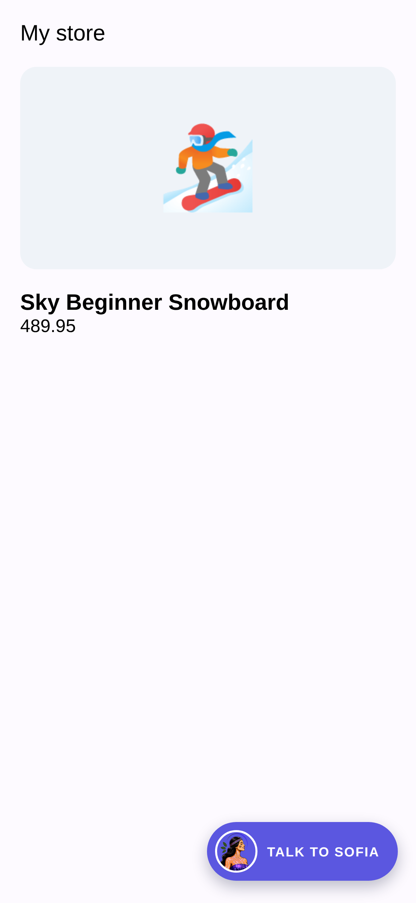
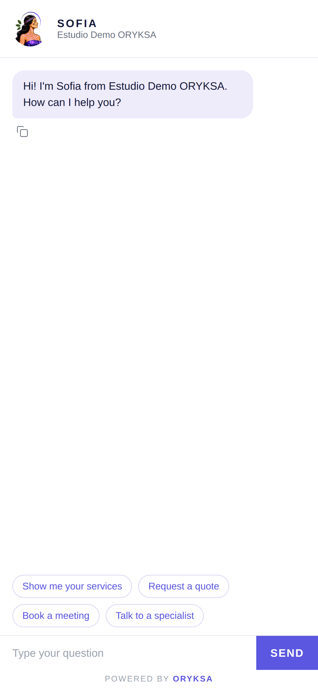
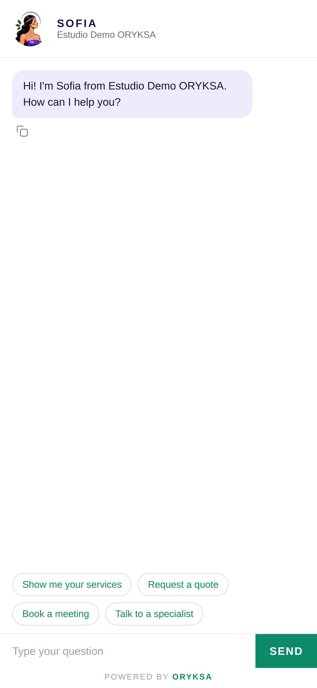

<p align="center"></p>

# @oryksa/react-native

[](README.md) [](README.pt.md) [](README.es.md) [](README.fr.md)

<p align="center"><a href="https://developer.oryksa.com/es/sdks"></a></p>

SDK oficial de React Native de **ORYKSA AI Employees**. Pon dentro de tu app iOS y Android (React Native o Expo) un empleado de IA que ya conoce tu negocio: un chat listo con el mismo aspecto que el chat de la web de ORYKSA, el nombre y la foto de tu IA desde tu cuenta ORYKSA, en inglés, portugués y español.

* Documentación: https://developer.oryksa.com/es/sdks
* API: `https://api.oryksa.com/v1`
* Sin código nativo: funciona en Expo Go.

## Capturas de pantalla

<p align="center">  </p>

Los propios componentes del SDK, dibujados por el CI en Chrome a tamaño de móvil con React Native for Web y una cuenta de prueba de ORYKSA (`test/web/`). En el móvil el chat muestra también el micrófono, que necesita las bibliotecas de audio nativas. El chat verde usa el código de *Colores y tema*, más abajo.

## Instalar

```bash
npm install @oryksa/react-native
```

## Para qué sirve

El SDK pone el chat y la voz de ORYKSA dentro de tu app para atender a los **clientes de tu negocio**: preguntan, compran y reservan. La IA responde con tu Brain, tus productos y tus servicios, con el nombre, la foto y la voz que elegiste en *Tu IA*, y guarda leads, reservas y ventas en las Actividades de tu cuenta ORYKSA. **No** es una interfaz para el dueño: a través del SDK nadie cambia ajustes, lee las Actividades ni da órdenes a ORYKSA. Más información: https://help.oryksa.com/es/a/sdks-what-they-do

Las palabrotas que escribe el cliente aparecen con asteriscos en el chat (la misma lista de todos los chats de ORYKSA, cargada desde `https://app.oryksa.com/widget/profanity.json` y guardada 24 horas). Las respuestas de la IA ya vienen filtradas desde el servidor.

## Voz y contexto de la app (1.1)

El chat muestra un micrófono cuando tu plan incluye voz. Abre la pantalla de voz con el mismo comportamiento que la app de ORYKSA: el micrófono sigue abierto mientras ella habla y solo una voz humana la interrumpe (el tecleo, la televisión y su propio eco no); se detiene en la palabra y el texto queda en el chat; a un susurro responde con un susurro; si su voz falla, se muestra el texto (nunca una voz robótica).

La voz necesita tres bibliotecas nativas (dependencias peer opcionales) y el permiso de micrófono (Android `RECORD_AUDIO`, iOS `NSMicrophoneUsageDescription`):

```sh
npm install react-native-live-audio-stream react-native-sound react-native-fs
```

Sin ellas, el chat funciona y el micrófono queda oculto. Con Expo u otra pila de audio: pasa tu propio adaptador `audio` (`startMic`, `stopMic`, `play`, `stopPlayback`).

Cada respuesta de la IA tiene un botón de copiar debajo. Usa `@react-native-clipboard/clipboard` cuando está instalado (dependencia peer opcional: `npm install @react-native-clipboard/clipboard`); las versiones antiguas de React Native usan el `Clipboard` integrado.

```jsx
<OryksaChatButton client={client} lang="pt"
  appContext={() => ({ screen: "product", title: "Sky Beginner Snowboard, 489.95" })} />
```

## Cómo funciona (y por qué la clave está segura)

1. Tu **servidor** guarda la clave secreta de la API (`oryk_live_...`, creada en developer.oryksa.com) y crea un **token de sesión** de corta duración para cada usuario que ha iniciado sesión, con `POST /v1/sessions` (con `@oryksa/sdk` en Node: `oryksa.createSession(...)`).
2. Tu **app** recibe solo ese token de sesión (`oryk_cs_...`). La clave secreta nunca entra en la app.
3. Cada respuesta de la IA cuenta como una interacción de tu plan ORYKSA, igual que en WhatsApp.

## En la app

```jsx
import { OryksaClient, OryksaChatButton } from "@oryksa/react-native";

const client = new OryksaClient({
  getToken: async () => (await fetch("https://your-server.example/oryksa-token").then((r) => r.json())).token,
});

export default function App() {
  return (
    <View style={{ flex: 1 }}>
      <MyScreens />
      <OryksaChatButton client={client} lang="en" /> {/* en, pt, br, es */}
    </View>
  );
}
```

Otras piezas:

* `<OryksaChatModal client={client} visible={open} onClose={() => setOpen(false)} />`: abre el chat desde tu propio botón.
* `<OryksaChat client={client} />`: el panel dentro de cualquier pantalla.
* `theme={{ accent: "#5B57E0" }}`: colores.
* Sin la interfaz: `await client.agent()`, `await client.sendAndWait("Are you open on Saturday?")`, `await client.messages()`.

## Mantén la IA sincronizada con tu app

En tu servidor, con `@oryksa/sdk`:

```js
await oryksa.learnApp({ name: "FitTrack", description: "...", screens: [...], faq: [...] });
```

## Errores

Las llamadas que fallan lanzan `OryksaError` con `status`, `code` (por ejemplo `interaction_limit_reached`, `rate_limited`, `plan_required`) y `message`.

## Colores y tema

La prop `theme` recibe un objeto con hasta cinco colores en texto hexadecimal: `accent` (botones, burbujas del visitante, enlaces), `ink` (texto principal), `soft` (burbujas de la IA), `background` (panel) y `muted` (texto secundario). Las claves que faltan mantienen el valor por defecto, así que `{ accent: "#0E8A6B" }` basta. Funciona en `OryksaChatButton`, `OryksaChatModal` y `OryksaChat`, y los valores por defecto se exportan como `DEFAULT_THEME`.

```jsx
const theme = { accent: "#0E8A6B" };

<OryksaChatButton client={client} lang="en" theme={theme} />
```

No hay tema oscuro automático: para el modo oscuro, pasa tus propios colores oscuros.

---

## Sobre el autor

**Weslley Harakawa** - Fundador de ORYKSA AI. En Lisboa, Portugal. Especialidades: inteligencia artificial, desarrollo web y móvil, tokenización en blockchain. Formación: University of the People.

- LinkedIn: https://www.linkedin.com/in/weslleyharakawa/
- ORYKSA AI Employees: https://oryksa.com (X: https://x.com/oryksa, Instagram: https://www.instagram.com/oryksaai, YouTube: https://www.youtube.com/@ORYKSA)

---

MIT License · ORYKSA AI Employees · W8 Atlantic Unipessoal Lda
