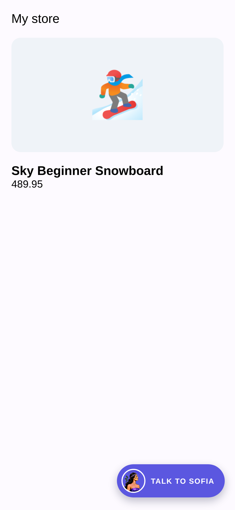
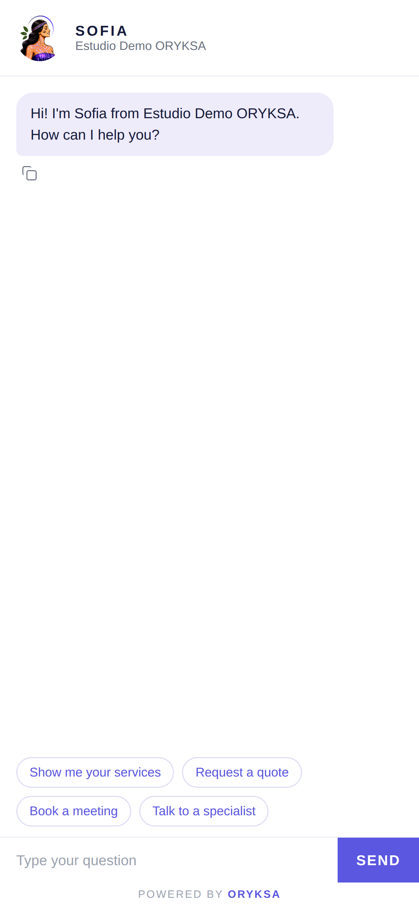
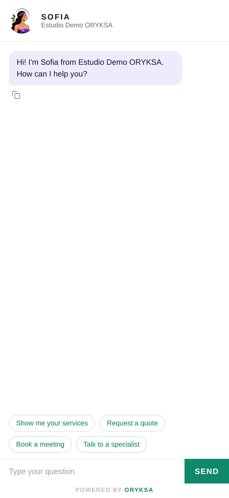

<p align="center"></p>

# @oryksa/react-native

[](README.md) [](README.pt.md) [](README.es.md) [](README.fr.md)

<p align="center"><a href="https://developer.oryksa.com/en/sdks"></a></p>

Official React Native SDK for **ORYKSA AI Employees**. Put an AI employee that already knows your business inside your iOS and Android app (React Native or Expo): a ready chat with the same look as the ORYKSA website chat, the name and photo of your AI from your ORYKSA account, in English, Portuguese and Spanish.

* Docs: https://developer.oryksa.com/en/sdks
* API: `https://api.oryksa.com/v1`
* No native code: works in Expo Go.

## Screenshots

<p align="center">  </p>

The SDK components themselves, rendered by CI in Chrome at phone size with React Native for Web and an ORYKSA test account (`test/web/`). On a phone the chat also shows the microphone, which needs the native audio libraries. The green chat uses the code of *Colours and theme* below.

## Install

```bash
npm install @oryksa/react-native
```

## What it is for

The SDK puts the ORYKSA chat and voice inside your app to serve the **customers of your business**: they ask, buy and book. The AI answers with your Brain, products and services, with the name, photo and voice you chose in *Your AI*, and saves leads, bookings and sales in the Activities of your ORYKSA account. It is **not** an interface for the owner: nobody changes settings, reads Activities or gives orders to ORYKSA through the SDK. More: https://help.oryksa.com/en/a/sdks-what-they-do

Swear words the customer types show as asterisks in the chat (the same list as every ORYKSA chat, loaded from `https://app.oryksa.com/widget/profanity.json`, kept 24 hours). The AI's replies already come filtered from the server.

## Voice and app context (1.1)

The chat shows a microphone when your plan has voice. It opens the voice screen with the same behaviour as the ORYKSA app: the microphone stays open while she speaks and only a human voice cuts her off (typing, TV and her own echo do not); she stops on the word and the text stays in the chat; a whisper gets a whispered answer; if her voice fails, the text is shown (never a robot voice).

Voice needs three native libraries (optional peer dependencies) and the microphone permission (Android `RECORD_AUDIO`, iOS `NSMicrophoneUsageDescription`):

```sh
npm install react-native-live-audio-stream react-native-sound react-native-fs
```

Without them the chat works and the microphone is hidden. Expo or another audio stack: pass your own `audio` adapter (`startMic`, `stopMic`, `play`, `stopPlayback`).

Each reply of the AI has a copy button under it. It uses `@react-native-clipboard/clipboard` when installed (optional peer dependency: `npm install @react-native-clipboard/clipboard`); older React Native versions use the built-in `Clipboard`.

```jsx
<OryksaChatButton client={client} lang="pt"
  appContext={() => ({ screen: "product", title: "Sky Beginner Snowboard, 489.95" })} />
```

## Links with an Open button (1.1.3)

The links the AI gives can be tapped in the chat (web addresses and e-mails), and each web link gets a card under her reply with the picture and title of the page and an **Open** button (the pages of your own site, the domains of your website chat; other sites show the address). The voice screen shows what she says without the addresses, with the same cards; tapping Open closes the voice screen. Pass `onLink` to open your own screens, for example your product page: return true when your app opened it, false to let the system open it (`Linking.openURL`).

```jsx
<OryksaChatButton client={client} lang="en"
  onLink={(url) => {
    const id = myProductIdOf(url); // your routes
    if (!id) return false;
    navigation.navigate("Product", { id });
    return true;
  }} />
```

`onLink` is also on `OryksaChat`, `OryksaChatModal` and `OryksaVoiceScreen`.

## How it works (and why the key stays safe)

1. Your **server** keeps the secret API key (`oryk_live_...`, created at developer.oryksa.com) and creates a short-lived **session token** for each signed-in user with `POST /v1/sessions` (with `@oryksa/sdk` on Node: `oryksa.createSession(...)`).
2. Your **app** receives only that session token (`oryk_cs_...`). The secret key never goes into the app.
3. Every AI reply counts as one interaction of your ORYKSA plan, the same as on WhatsApp.

## In the app

```jsx
import { OryksaClient, OryksaChatButton } from "@oryksa/react-native";

const client = new OryksaClient({
  getToken: async () => (await fetch("https://your-server.example/oryksa-token").then((r) => r.json())).token,
});

export default function App() {
  return (
    <View style={{ flex: 1 }}>
      <MyScreens />
      <OryksaChatButton client={client} lang="en" /> {/* en, pt, br, es */}
    </View>
  );
}
```

Other pieces:

* `<OryksaChatModal client={client} visible={open} onClose={() => setOpen(false)} />`: open the chat from your own button.
* `<OryksaChat client={client} />`: the panel inside any screen.
* `theme={{ accent: "#5B57E0" }}`: colors.
* Without the UI: `await client.agent()`, `await client.sendAndWait("Are you open on Saturday?")`, `await client.messages()`.

## Keep the AI in sync with your app

On your server, with `@oryksa/sdk`:

```js
await oryksa.learnApp({ name: "FitTrack", description: "...", screens: [...], faq: [...] });
```

## Errors

Failed calls throw `OryksaError` with `status`, `code` (for example `interaction_limit_reached`, `rate_limited`, `plan_required`) and `message`.

## Colours and theme

The `theme` prop takes an object with up to five colors as hex strings: `accent` (buttons, visitor bubbles, links), `ink` (main text), `soft` (AI bubbles), `background` (panel) and `muted` (secondary text). Missing keys keep the default, so `{ accent: "#0E8A6B" }` is enough. It works on `OryksaChatButton`, `OryksaChatModal` and `OryksaChat`, and the defaults are exported as `DEFAULT_THEME`.

```jsx
const theme = { accent: "#0E8A6B" };

<OryksaChatButton client={client} lang="en" theme={theme} />
```

There is no automatic dark theme: for dark mode, pass your own dark colors.

---

## About the author

**Weslley Harakawa** - Founder of ORYKSA AI. Based in Lisbon, Portugal. Specialties: artificial intelligence, web and mobile development, blockchain tokenization. Education: University of the People.

- LinkedIn: https://www.linkedin.com/in/weslleyharakawa/
- ORYKSA AI Employees: https://oryksa.com (X: https://x.com/oryksa, Instagram: https://www.instagram.com/oryksaai, YouTube: https://www.youtube.com/@ORYKSA)

---

MIT License · ORYKSA AI Employees · W8 Atlantic Unipessoal Lda
