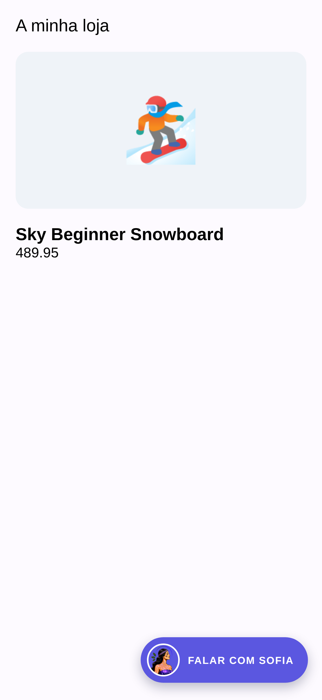
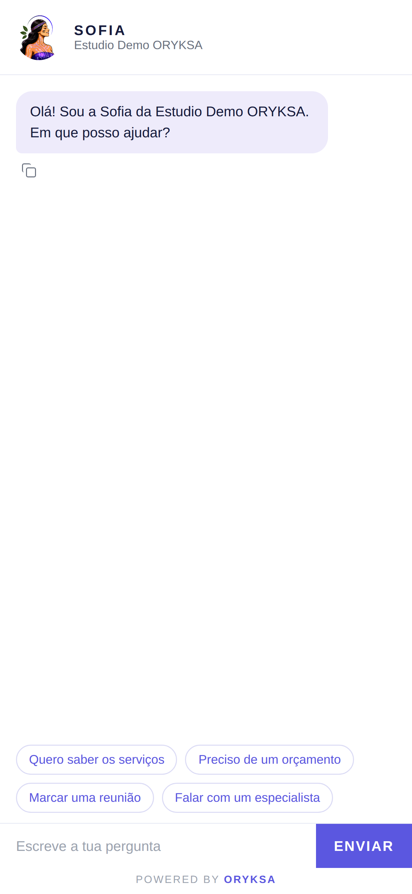
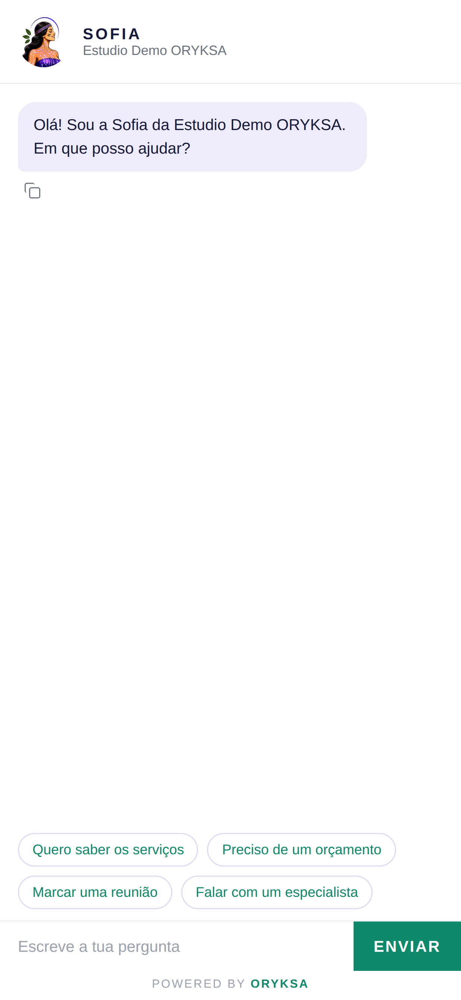

<p align="center"></p>

# @oryksa/react-native

[](README.md) [](README.pt.md) [](README.es.md) [](README.fr.md)

<p align="center"><a href="https://developer.oryksa.com/pt/sdks"></a></p>

SDK oficial de React Native da **ORYKSA AI Employees**. Põe dentro da tua app iOS e Android (React Native ou Expo) um colaborador de IA que já conhece o teu negócio: um chat pronto com o mesmo aspeto do chat do site da ORYKSA, o nome e a foto da tua IA vindos da tua conta ORYKSA, em inglês, português e espanhol.

* Documentação: https://developer.oryksa.com/pt/sdks
* API: `https://api.oryksa.com/v1`
* Sem código nativo: funciona no Expo Go.

## Capturas de ecrã

<p align="center">  </p>

Os próprios componentes do SDK, desenhados pelo CI no Chrome em tamanho de telemóvel com React Native for Web e uma conta de teste da ORYKSA (`test/web/`). No telemóvel o chat mostra também o microfone, que precisa das bibliotecas de áudio nativas. O chat verde usa o código de *Cores e tema*, mais abaixo.

## Instalar

```bash
npm install @oryksa/react-native
```

## Para que serve

O SDK põe o chat e a voz da ORYKSA dentro da tua app para atender os **clientes do teu negócio**: eles perguntam, compram e marcam. A IA responde com o teu Brain, os teus produtos e serviços, com o nome, a foto e a voz que escolheste em *A tua IA*, e guarda leads, marcações e vendas nas Atividades da tua conta ORYKSA. **Não** é uma interface para o dono: ninguém altera definições, lê Atividades ou dá ordens à ORYKSA através do SDK. Mais: https://help.oryksa.com/pt/a/sdks-what-they-do

Os palavrões que o cliente escreve aparecem como asteriscos no chat (a mesma lista de todos os chats da ORYKSA, carregada de `https://app.oryksa.com/widget/profanity.json` e guardada durante 24 horas). As respostas da IA já vêm filtradas do servidor.

## Voz e contexto da app (1.1)

O chat mostra um microfone quando o teu plano tem voz. Abre o ecrã de voz com o mesmo comportamento da app ORYKSA: o microfone fica aberto enquanto ela fala e só uma voz humana a interrompe (escrever, a TV e o eco dela própria não); ela para na palavra e o texto fica no chat; um sussurro recebe uma resposta sussurrada; se a voz dela falhar, aparece o texto (nunca uma voz de robô).

A voz precisa de três bibliotecas nativas (dependências peer opcionais) e da permissão do microfone (Android `RECORD_AUDIO`, iOS `NSMicrophoneUsageDescription`):

```sh
npm install react-native-live-audio-stream react-native-sound react-native-fs
```

Sem elas, o chat funciona e o microfone fica escondido. Expo ou outra stack de áudio: passa o teu próprio adaptador `audio` (`startMic`, `stopMic`, `play`, `stopPlayback`).

Cada resposta da IA tem um botão de copiar por baixo. Usa `@react-native-clipboard/clipboard` quando está instalado (dependência peer opcional: `npm install @react-native-clipboard/clipboard`); as versões mais antigas do React Native usam o `Clipboard` integrado.

```jsx
<OryksaChatButton client={client} lang="pt"
  appContext={() => ({ screen: "product", title: "Sky Beginner Snowboard, 489.95" })} />
```

## Links com botão Abrir (1.1.3)

Os links que a IA dá ficam clicáveis no chat (endereços web e e-mails), e cada link web ganha um cartão por baixo da resposta com a foto e o título da página e um botão **Abrir** (as páginas do teu próprio site, os domínios do teu chat do site; outros sites mostram o endereço). O ecrã de voz mostra o que ela diz sem os endereços, com os mesmos cartões; tocar em Abrir fecha o ecrã de voz. Passa `onLink` para abrir os teus próprios ecrãs, por exemplo a página do produto: devolve true quando a tua app o abriu, false para o sistema o abrir (`Linking.openURL`).

```jsx
<OryksaChatButton client={client} lang="pt"
  onLink={(url) => {
    const id = myProductIdOf(url); // as tuas rotas
    if (!id) return false;
    navigation.navigate("Product", { id });
    return true;
  }} />
```

`onLink` também existe em `OryksaChat`, `OryksaChatModal` e `OryksaVoiceScreen`.

## Anexar uma foto ou um documento (1.1.3)

O chat tem um botão de anexar (um clipe, ligado por omissão): uma foto da galeria, uma foto da câmara ou um documento (PDF, Word, texto, CSV, até 8 MB). A IA vê a foto (reduzida a 1600 píxeis, JPEG 80%, até 2 MB) e lê o documento; o balão do cliente mostra a foto, ou o ícone do documento e o nome. `attachments={false}` esconde o botão.

O React Native não tem seletor próprio, por isso o SDK usa duas bibliotecas opcionais que a tua app instala (dependências peer opcionais, como as da voz). Cada opção só aparece quando a sua biblioteca existe; sem as duas, o botão fica escondido:

```sh
npm install react-native-image-picker @react-native-documents/picker
```

* `react-native-image-picker`: galeria e câmara. Info.plist do iOS: `NSPhotoLibraryUsageDescription` e `NSCameraUsageDescription`. Android: nenhuma permissão para a galeria; para a câmara, `CAMERA` só é precisa se a tua app a declarar no seu próprio manifest (então concede-a antes de a câmara abrir).
* `@react-native-documents/picker`: documentos, no seletor de documentos do sistema (sem permissão). Os documentos são lidos com `react-native-fs` quando está instalado, senão com `fetch`.

```jsx
<OryksaChatButton client={client} lang="pt" attachments={false} /> {/* sem botão de anexar */}

// Expo ou outra stack: os teus próprios seletores (um que falte esconde essa opção)
const picker = {
  pickPhoto: () => myPhotoPicker(), // { base64, mime } reduzida (1600 px, JPEG 80%), ou null
  pickDocument: () => myDocumentPicker(), // { base64, name, mime }, ou null
};
<OryksaChat client={client} picker={picker} />
```

Sem a interface: `client.send("Aqui está o orçamento", { file: { base64, name: "orcamento.pdf", mime: "application/pdf" } })` (fotos: `{ image: { base64, mime } }`).

## Como funciona (e porque é que a chave fica segura)

1. O teu **servidor** guarda a chave secreta da API (`oryk_live_...`, criada em developer.oryksa.com) e cria um **token de sessão** de curta duração para cada utilizador com sessão iniciada, com `POST /v1/sessions` (com `@oryksa/sdk` em Node: `oryksa.createSession(...)`).
2. A tua **app** recebe só esse token de sessão (`oryk_cs_...`). A chave secreta nunca entra na app.
3. Cada resposta da IA conta como uma interação do teu plano ORYKSA, tal como no WhatsApp.

## Na app

```jsx
import { OryksaClient, OryksaChatButton } from "@oryksa/react-native";

const client = new OryksaClient({
  getToken: async () => (await fetch("https://your-server.example/oryksa-token").then((r) => r.json())).token,
});

export default function App() {
  return (
    <View style={{ flex: 1 }}>
      <MyScreens />
      <OryksaChatButton client={client} lang="en" /> {/* en, pt, br, es */}
    </View>
  );
}
```

Outras peças:

* `<OryksaChatModal client={client} visible={open} onClose={() => setOpen(false)} />`: abre o chat a partir do teu próprio botão.
* `<OryksaChat client={client} />`: o painel dentro de qualquer ecrã.
* `theme={{ accent: "#5B57E0" }}`: cores.
* Sem a interface: `await client.agent()`, `await client.sendAndWait("Are you open on Saturday?")`, `await client.messages()`.

## Mantém a IA sincronizada com a tua app

No teu servidor, com `@oryksa/sdk`:

```js
await oryksa.learnApp({ name: "FitTrack", description: "...", screens: [...], faq: [...] });
```

## Erros

As chamadas falhadas lançam `OryksaError` com `status`, `code` (por exemplo `interaction_limit_reached`, `rate_limited`, `plan_required`) e `message`.

## Cores e tema

A prop `theme` recebe um objeto com até cinco cores em texto hexadecimal: `accent` (botões, balões do visitante, ligações), `ink` (texto principal), `soft` (balões da IA), `background` (painel) e `muted` (texto secundário). As chaves em falta mantêm o valor por omissão, por isso `{ accent: "#0E8A6B" }` basta. Funciona em `OryksaChatButton`, `OryksaChatModal` e `OryksaChat`, e os valores por omissão são exportados como `DEFAULT_THEME`.

```jsx
const theme = { accent: "#0E8A6B" };

<OryksaChatButton client={client} lang="en" theme={theme} />
```

Não há tema escuro automático: para o modo escuro, passa as tuas próprias cores escuras.

---

## Sobre o autor

**Weslley Harakawa** - Fundador da ORYKSA AI. Em Lisboa, Portugal. Especialidades: inteligência artificial, desenvolvimento web e mobile, tokenização em blockchain. Formação: University of the People.

- LinkedIn: https://www.linkedin.com/in/weslleyharakawa/
- ORYKSA AI Employees: https://oryksa.com (X: https://x.com/oryksa, Instagram: https://www.instagram.com/oryksaai, YouTube: https://www.youtube.com/@ORYKSA)

---

MIT License · ORYKSA AI Employees · W8 Atlantic Unipessoal Lda
